<div align="center">


<a href="docs/Glace_eKaru_Informe_final.pdf"></a>

<a href="#-las-17-páginas-clic-para-ampliar"></a>

</div>

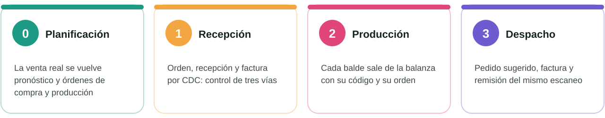

### 🔁 El ciclo completo

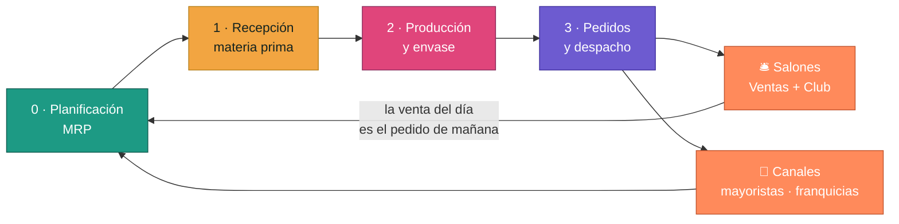

### 🔎 Las 17 páginas (clic para ampliar)

Cada miniatura abre la página en tamaño real (2600 px de ancho): en GitHub se puede acercar con un clic y moverse por las tablas y los diagramas.

> [!TIP]
> **Visor con zoom:** [Glacé × e-Karú · Visor del informe](https://claude.ai/artifact/WfckNi11dfU8bmnRuTp2d5): clic en cualquier tabla o diagrama y se acerca a ella; **Espacio** (o «Tabla ›») salta a la siguiente, también de una página a otra: 66 tablas y diagramas en total. Tiene índice con búsqueda y vista de todas las páginas. Es privado: se comparte desde claude.ai.

<table>
<tr><td align="center" width="25%"><a href="docs/paginas/01_ov.jpg">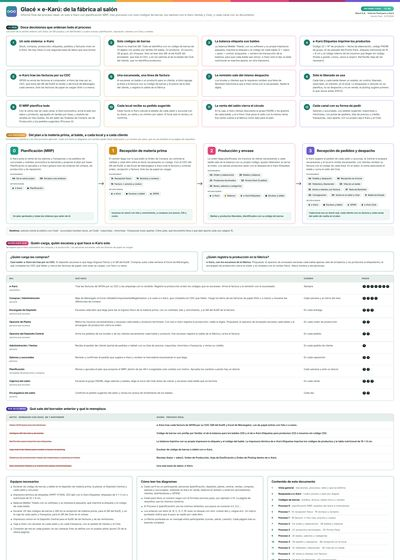</a><br><sub><b>1</b> · Vista general</sub></td><td align="center" width="25%"><a href="docs/paginas/02_resp.jpg">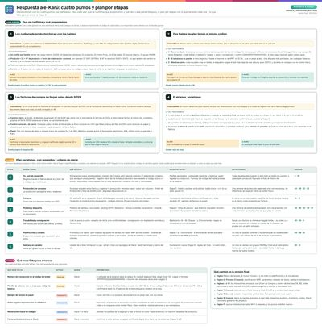</a><br><sub><b>2</b> · Respuesta a e-Karú</sub></td><td align="center" width="25%"><a href="docs/paginas/03_codes.jpg">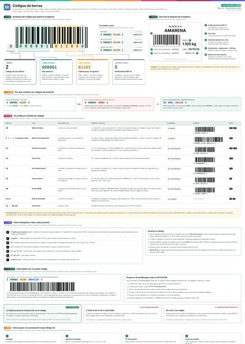</a><br><sub><b>3</b> · Códigos de barras</sub></td><td align="center" width="25%"><a href="docs/paginas/04_p0.jpg">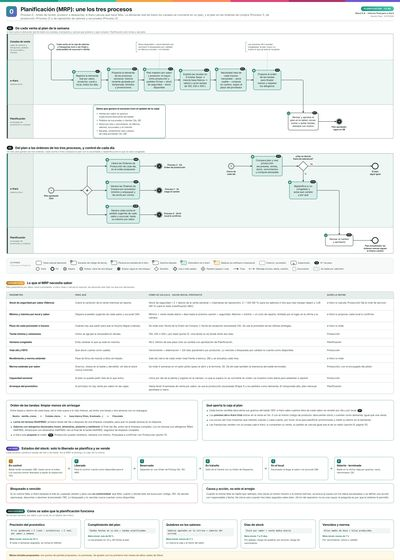</a><br><sub><b>4</b> · Proceso 0 · Planificación (MRP)</sub></td></tr>
<tr><td align="center" width="25%"><a href="docs/paginas/05_p1a.jpg">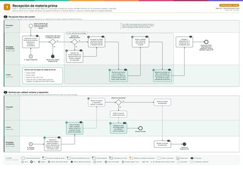</a><br><sub><b>5</b> · Proceso 1 · Recepción de materia prima</sub></td><td align="center" width="25%"><a href="docs/paginas/06_p1b.jpg">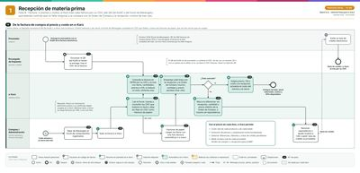</a><br><sub><b>6</b> · Proceso 1 · 1B factura por CDC → tres vías, precios y costos</sub></td><td align="center" width="25%"><a href="docs/paginas/07_p2a.jpg">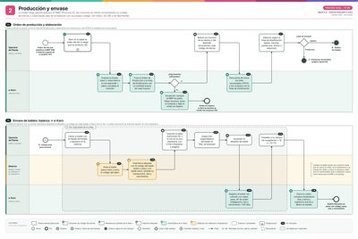</a><br><sub><b>7</b> · Proceso 2 · Producción y envase</sub></td><td align="center" width="25%"><a href="docs/paginas/08_p2b.jpg">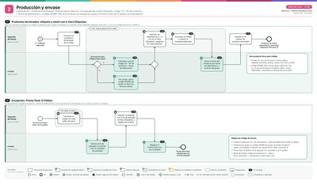</a><br><sub><b>8</b> · Proceso 2 · 2C productos terminados · 2D Promo Pack 12 palitos</sub></td></tr>
<tr><td align="center" width="25%"><a href="docs/paginas/09_p2c.jpg">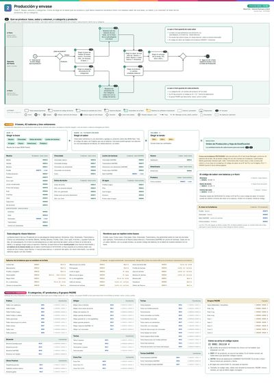</a><br><sub><b>9</b> · Proceso 2 · 2E bases, sabores y categorías</sub></td><td align="center" width="25%"><a href="docs/paginas/10_p3a.jpg">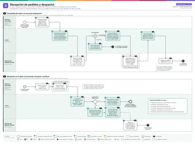</a><br><sub><b>10</b> · Proceso 3 · Pedidos y despacho</sub></td><td align="center" width="25%"><a href="docs/paginas/11_p3b.jpg">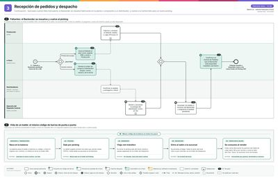</a><br><sub><b>11</b> · Proceso 3 · 3C faltantes y Backorder · 3D vida de un balde</sub></td><td align="center" width="25%"><a href="docs/paginas/12_p3c.jpg">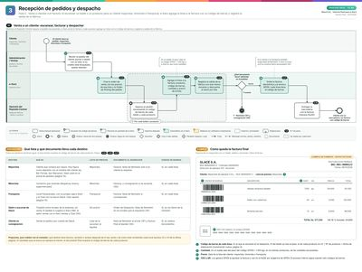</a><br><sub><b>12</b> · Proceso 3 · 3E venta a clientes con factura</sub></td></tr>
<tr><td align="center" width="25%"><a href="docs/paginas/13_p3d.jpg">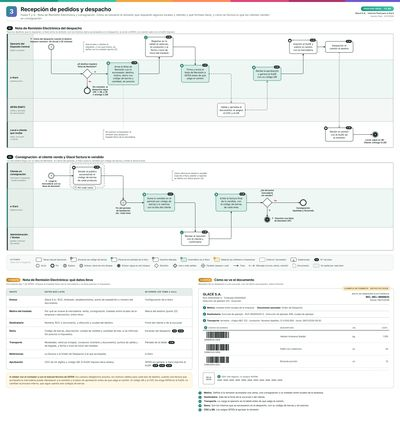</a><br><sub><b>13</b> · Proceso 3 · 3F Nota de Remisión · 3G consignación</sub></td><td align="center" width="25%"><a href="docs/paginas/14_p3h.jpg">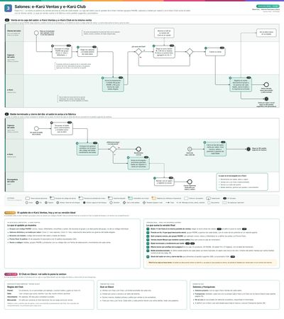</a><br><sub><b>14</b> · Salones</sub></td><td align="center" width="25%"><a href="docs/paginas/15_canales.jpg">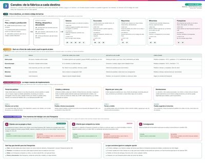</a><br><sub><b>15</b> · Canales</sub></td><td align="center" width="25%"><a href="docs/paginas/16_ops.jpg">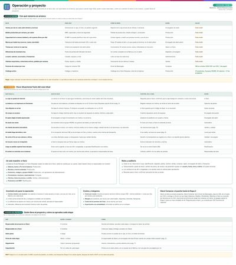</a><br><sub><b>16</b> · Operación y proyecto</sub></td></tr>
<tr><td align="center" width="25%"><a href="docs/paginas/17_scope.jpg">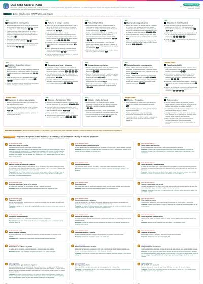</a><br><sub><b>17</b> · Qué debe hacer e-Karú · módulos (MVP), puntos a definir y material de ejemplo</sub></td></tr>
</table>

## 🧭 En una frase por proceso

| | Proceso | Qué cambia |
|:-:|---|---|
| **0** | **Planificación (MRP)** | La venta real de todos los canales se convierte en pronóstico, plan por sabor y producto, y órdenes de compra, producción y reposición. Ventana congelada de 48 h. |
| **1** | **Recepción de materia prima** | Cada entrega llega con su Orden de Compra; la factura se trae por su CDC y se controla en tres vías: orden, recepción y factura. |
| **2** | **Producción y envase** | La orden llega planificada; cada balde sale de la balanza con su código, el Nº de orden y queda «liberado» al cerrar la orden. |
| **3** | **Pedidos y despacho** | Cada salón y sucursal recibe su pedido sugerido; los clientes, su factura con el código de cada línea; la Nota de Remisión sale del mismo escaneo. |
| **🛎️** | **Salones** | La caja usa el update de **e-Karú Ventas** (grupos PADRE, sabores y balde por sabor) y **e-Karú Club** pone el sello con la misma venta. |
| **🚚** | **Canales** | Salones, sucursales, mayoristas, minoristas y franquicias (caso aparte), cada uno con su forma de pedir, su precio y su documento. |

<p align="center"></p>


## 📈 Planificación (Proceso 0)

De cada venta al plan de la semana, y del plan a las órdenes. Parámetros (stock de seguridad, mínimo y máximo por local, merma, capacidad, arranque del pronóstico), estados del stock y calidad, e indicadores.

<p align="center"></p>


## 🏭 Producción con balde liberado

<p align="center"></p>


## 🛎️ Salones: e-Karú Ventas + e-Karú Club

La venta en la caja descuenta el grupo PADRE y los gramos de cada balde, y suma el sello del Club. Cuando un balde se vacía, e-Karú controla su rendimiento; al cierre, la venta del día se convierte en el pedido sugerido de mañana.

<p align="center">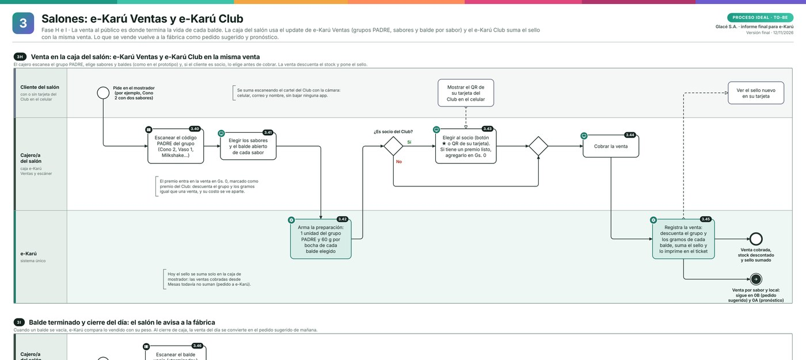</p>


## 🚚 Canales y franquicias

<p align="center"></p>


## ⚙️ Operación y proyecto

Datos de partida (lo que falta medir está marcado), doce situaciones fuera del caso ideal, un solo maestro de datos, auditoría, inventario rotativo, costos y márgenes, Glacé Compras como puente y el gobierno del proyecto.

<p align="center">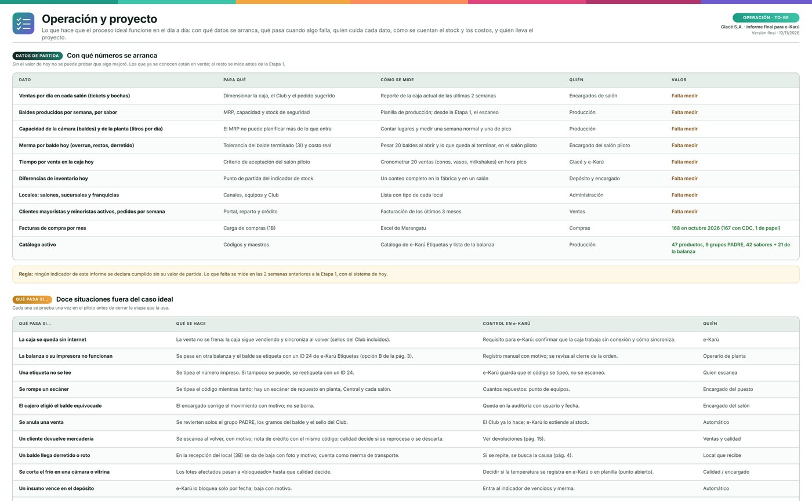</p>


## 📑 Contenido del PDF

| Pág. | Contenido |
|:-:|---|
| 1 | Vista general: doce decisiones, procesos, roles e índice |
| 2 | Respuesta a e-Karú: cuatro puntos y plan por etapas (MVP = Etapas 0–3 + salón piloto) |
| 3 | Códigos de barras: prefijos, reglas de lectura, balde único, cambio en 8 pasos |
| 4 | **Proceso 0** · planificación MRP, parámetros, estados del stock e indicadores |
| 5–6 | **Proceso 1** · recepción física, rechazo, factura por CDC y control de tres vías |
| 7–9 | **Proceso 2** · orden y envase, productos terminados, Promo Pack, bases y sabores |
| 10–13 | **Proceso 3** · pedidos, recepción en el local, faltantes, factura, remisión, consignación |
| 14 | **Salones** · venta con e-Karú Ventas y Club, balde terminado |
| 15 | **Canales** · mayoristas, minoristas y franquicias como caso aparte |
| 16 | **Operación y proyecto** · datos de partida, qué pasa si, costos y gobierno |
| 17 | **Qué debe hacer e-Karú** · 15 módulos (MVP o después), puntos a definir y material de ejemplo |


## 🏷️ Códigos de barra en una tabla

| Prefijo | Uso | Ejemplo |
|---|---|---|
| `2` + sabor + peso | Balde (lo imprime la balanza) | `2 000001 01105 8` |
| `2` + … + transacción | Balde único, Code 128 de 21 dígitos (propuesta) | `2 000001 01105 00041129 3` |
| `22` | Producto: Nº de producto + fecha de elaboración | `22 0001 261110 4` |
| `23` / `24` / `25` | Promo Pack · ID de balde · insumo interno | |
| `29` | Grupo PADRE | `2 900002 80008 1` |

<p align="center">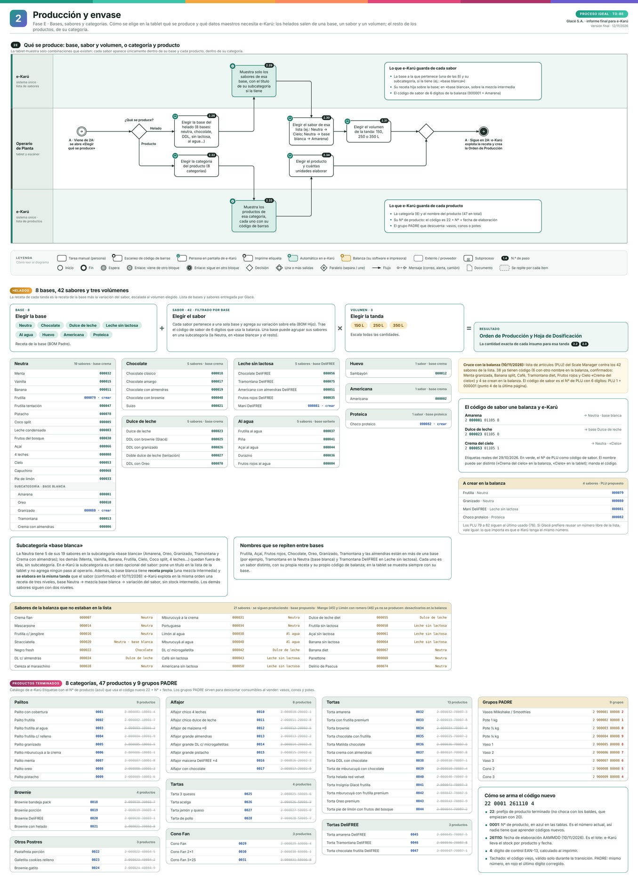</p>


## 🧪 Cómo se genera

`src/` tiene un motor propio de diagramas BPMN en JavaScript (`engine.js`), una página por archivo (`p0.js`, `p1a.js` … `p3h.js`, `canales.js`, `ops.js`, `textpages.js`) y los datos (`catalog.js`: catálogo, bases, sabores y códigos de balanza).

```bash
pip install playwright pypdf && playwright install chromium
cd src
# primero las páginas con diagramas, después las de texto (la numeración de pasos depende del orden)
python build.py p1a p1b p2a p2b p2c p3a p3b p3c p3d p3h p0 ov resp codes canales ops scope --pdf --nopng
python merge.py   # une las 17 páginas en out/Glace_eKaru_Informe_final.pdf
```

> [!TIP]
> `build.py` avisa si dos elementos de un diagrama se superponen o si un texto no entra (`warns=`); la versión publicada tiene 0 avisos.

> [!IMPORTANT]
> Las facturas y remisiones de ejemplo dentro del PDF son ficticias. Los valores marcados «propuesta» o «falta medir» los decide o mide Glacé.


<div align="center">

<sub>Parte de: [ekaru-etiquetas](https://github.com/alvaroliuzzi-bot/ekaru-etiquetas) · [glace-compras](https://github.com/alvaroliuzzi-bot/glace-compras) · [paginas-web](https://github.com/alvaroliuzzi-bot/paginas-web)</sub>

</div>
