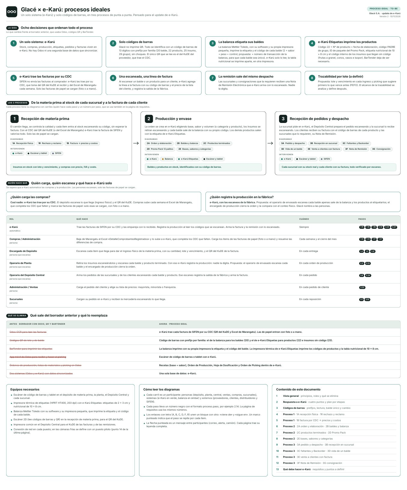
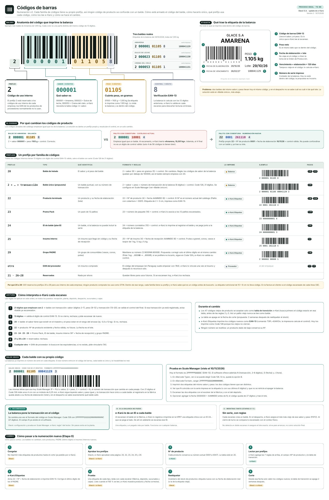
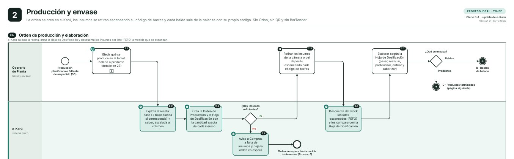
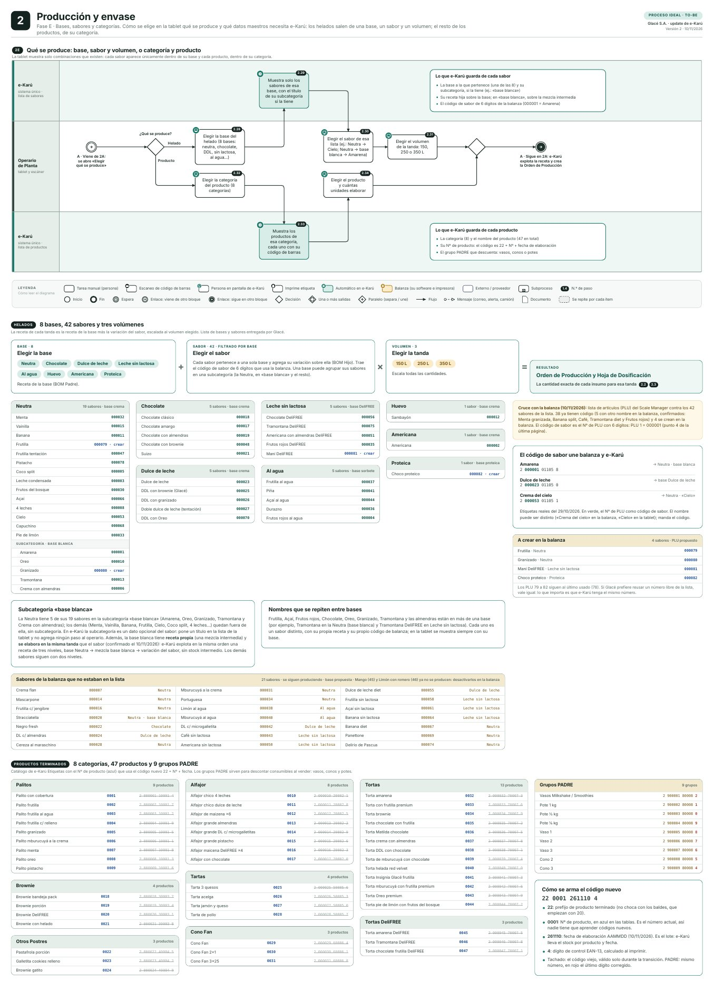

<div align="center">

# 🍦 Glacé × e-Karú · Procesos ideales

**Cómo debería trabajar una fábrica de helados con un solo sistema y solo códigos de barra**


### [📄 Abrir el documento (PDF)](docs/Glace_eKaru_Procesos_ideales.pdf)

</div>

---

## De qué se trata

Documento para el equipo de desarrollo de **e-Karú** con el proceso ideal (TO-BE) de Glacé en tres áreas, sin Odoo, sin QR y sin BarTender:

| | Proceso | Qué resuelve |
|---|---|---|
| **1** | Recepción de materia prima | Factura traída por su CDC (QR del KuDE + Excel de Marangatu), control de cantidades, facturas de papel |
| **2** | Producción y envase | Orden y Hoja de Dosificación, FEFO, baldes etiquetados por la balanza, 8 bases y 42 sabores |
| **3** | Pedidos y despacho | Picking por escaneo, factura con código de barras, Nota de Remisión, consignación |

Además: la **respuesta a los cuatro puntos de e-Karú** (códigos que chocan, balde único, facturas de compra, plan por etapas 0–4) y la **lista de puntos abiertos** ordenada por quién tiene que responder.

<p align="center"> </p>

## Códigos de barra en una tabla

| Prefijo | Uso | Ejemplo |
|---|---|---|
| `2` + sabor + peso | Balde (lo imprime la balanza) | `2 000001 01105 8` |
| `2` + … + transacción | Balde único, Code 128 de 21 dígitos (propuesta) | `2 000001 01105 00041129 3` |
| `22` | Producto: Nº de producto + fecha de elaboración | `22 0001 261110 4` |
| `23` / `24` / `25` | Promo Pack · ID de balde · insumo interno | |
| `29` | Grupo PADRE | |

<p align="center"></p>
<p align="center"></p>

## Contenido del PDF

| Pág. | Contenido |
|---|---|
| 1 | Visión general, roles, índice |
| 2 | Respuesta a e-Karú: cuatro puntos y plan por etapas |
| 3 | Códigos de barra: prefijos, reglas de lectura, balde único, cambio en 8 pasos |
| 4–5 | Proceso 1 · recepción y facturas |
| 6–8 | Proceso 2 · producción, baldes, productos, bases y sabores |
| 9–12 | Proceso 3 · pedidos, despacho, remisión, consignación |
| 13 | Qué debe hacer e-Karú y puntos abiertos |

## Cómo se genera

`src/` tiene un motor propio de diagramas BPMN en JavaScript (`engine.js`), una página por archivo (`p1a.js` … `p3d.js`, `textpages.js`) y los datos (`catalog.js`: catálogo, bases, sabores y códigos de balanza).

```bash
pip install playwright pypdf && playwright install chromium
cd src
# primero las páginas con diagramas, después las de texto (la numeración de pasos depende del orden)
python build.py p1a p1b p2a p2b p2c p3a p3b p3c p3d ov resp codes scope --pdf --nopng
python merge.py   # une las 13 páginas en out/Glace_eKaru_Procesos_ideales.pdf
```

`build.py` avisa si dos elementos de un diagrama se superponen (`warns=`); la versión publicada tiene 0 avisos.

> Las facturas y remisiones de ejemplo dentro del PDF son ficticias.

---

<sub>Parte de: [ekaru-etiquetas](https://github.com/alvaroliuzzi-bot/ekaru-etiquetas) · [glace-compras](https://github.com/alvaroliuzzi-bot/glace-compras) · [paginas-web](https://github.com/alvaroliuzzi-bot/paginas-web)</sub>
